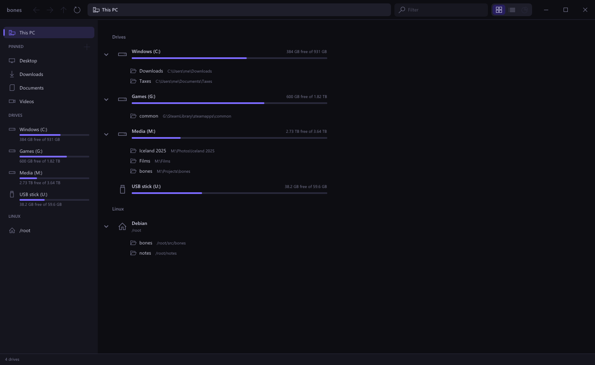
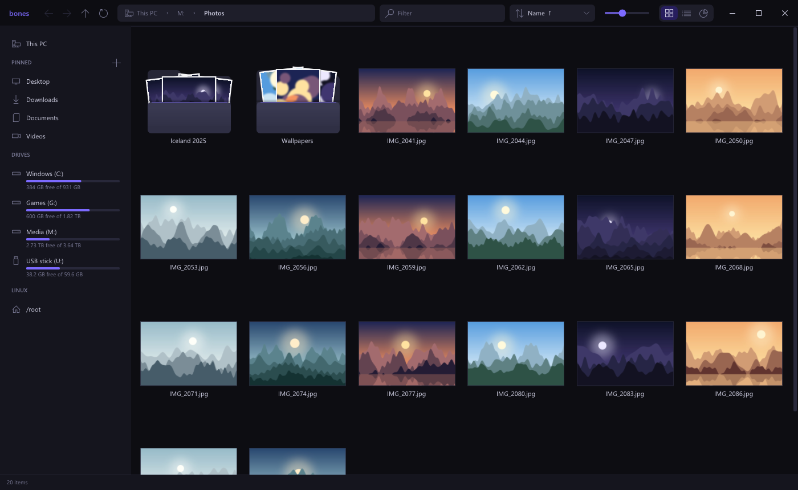
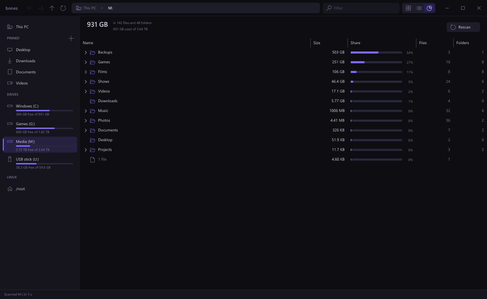
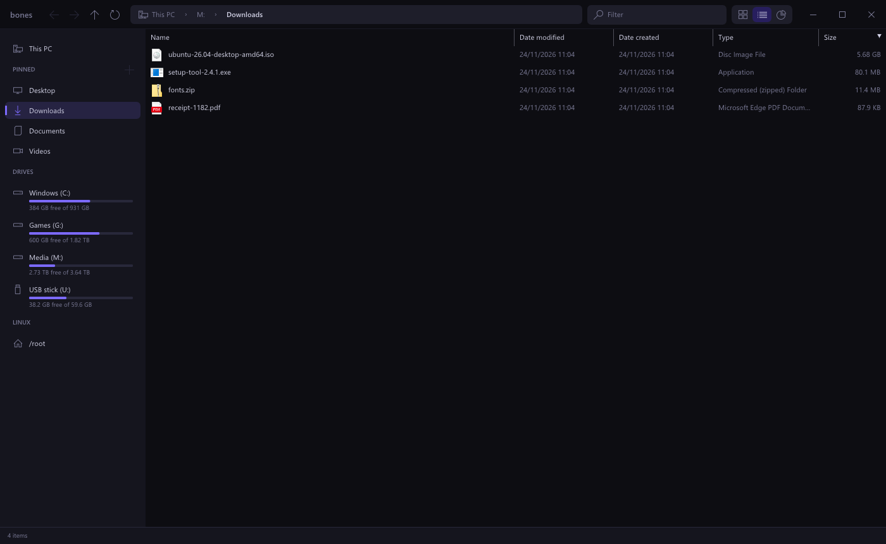

# bones

A plain file browser for Windows: drives, pinned folders and your WSL home
down the side, and a folder as thumbnails, details or sizes. None of
Explorer's ribbon, Home page, gallery, OneDrive or network clutter.

(The screenshots are of made-up drives and files: see
[Screenshots](#screenshots).)

- **This PC** is where it opens (unless given a folder): a list of the
  drives with their free space and the default WSL distro's home, each
  with its three most used folders under it. Like a folder, a click
  selects and a double-click (or Enter) opens. A visit counts once you've
  stayed 2 seconds (so folders you click through don't), and old visits
  fade by half every two weeks. Right-click a folder there to hide it
  (it's no longer counted); a drive's right-click menu shows hidden ones
  again. It's at
  the top of the sidebar, the first step of the path bar, and Up from a
  drive.
- **Sidebar**: pinned folders (+ pins where you are, drag to reorder,
  right-click to move or unpin), every drive with its free space, and
  the default WSL distro's home (`/root`; other distros are left out, and
  `/` is one step up the path bar). It's read from the registry, so a
  stopped distro isn't started until you click it.
- **Sizes** (Ctrl+3, or "Show sizes" on a drive's right-click menu on This
  PC): what's taking the space under the folder, like TreeSize. A scan
  runs in the background (4 threads, below normal priority; C: with 1.5M
  files takes about 50 s) and the tree fills in as it goes: folders
  biggest first, each with its share of the folder above, files and
  folders counted; a folder's own files show as one "N files" row.
  Arrows or the chevrons open folders, double-click or Enter goes in
  (the scan is kept, so going deeper is instant), Del recycles a scanned
  folder (it comes off the totals), F5 or Rescan starts again.
  Junctions and symlinks aren't followed; OneDrive's online-only files
  count as nothing. Folders it can't read (other users', System Volume
  Information) are marked; on a drive's root it says how much of the
  used space it couldn't find.
- **Thumbnails or details** (Ctrl+1 / Ctrl+2), chosen per folder: a
  folder that's mostly pictures and videos (at least 3 and half its files,
  or 20 or more) opens as thumbnails, anything else as details. A view
  picked by hand in a folder sticks for that folder (the last 500 are
  kept). Right-click › View › "Choose by what's in the folder" turns the
  automatic part off. "Folders first" (sort menu,
  or right-click empty space > Sort by) can be turned off to sort folders
  in with the files. Details sorts by name,
  date modified, date created, type or size from the headers; the
  thumbnail view has the same sort in a menu, and a size slider
  (or Ctrl+scroll).
- **Thumbnails, faster than Explorer's**:
  - only what's on screen (and the next screen down) is asked for, newest
    first, so a fast scroll doesn't queue up everything it went past;
  - images are decoded by WIC straight at a small size: JPEGs are scaled
    inside the decoder (1/2, 1/4, 1/8), so a 24 MP photo never decodes in
    full; camera raws use their embedded preview; EXIF rotation is applied;
  - videos, PDFs and the like go to the shell's own thumbnailers, on
    threads of their own so they never hold up the images;
  - everything goes in bones's own disk cache (`%LOCALAPPDATA%\bones\thumbs`,
    keyed by path, size and time, kept under 1 GB), which also covers WSL
    and network folders that Windows doesn't cache;
  - the worker threads run at below-normal priority.

  On a test folder of 120 4000×3000 JPEGs, 8 PNGs and 3 videos: 0.6 s
  for all of them the first time, 0.27 s from the cache, against 1.8 s
  through the shell's thumbnail route (what Explorer uses) with five
  threads.
- Files: open (Enter, double-click), Open with, cut/copy/paste (Explorer's
  clipboard, so it works both ways, with the shell's progress and clash
  dialogs), rename in place (F2), recycle (Del; Shift+Del deletes), new
  folder (Ctrl+Shift+N), copy path (Ctrl+Shift+C; Linux paths too),
  properties (Alt+Enter), drag files out to other apps and drop files in,
  and "More options…" for Explorer's own right-click menu.
- Moving about: Alt+Left/Right and the mouse's side buttons, Backspace for
  up, click the path bar (or Ctrl+L) to type a path; a `/linux/path` opens
  in the default distro. Ctrl+F filters the folder (`*.jpg` works). Typing
  a name's start jumps to it.
- Folders show what's in them: up to three of their pictures (or
  videos) fanned out in the folder, pictures first, by name. They're drawn
  in the app's slate colours rather than Windows' yellow.
- The folder refreshes itself when its contents change.

## Default for folders

`scripts\default-folders.ps1` makes bones the way folders and drives open for
your user (double-clicking a folder, "open folder" in other apps,
`start C:\x`); `-Undo` puts Explorer back. It only writes under
`HKCU\Software\Classes`: an "Open in bones" verb on `Directory` and `Drive`,
named as the default there and on `Folder`. Virtual folders (This PC, Recycle
Bin, Control Panel) have no such verb, so they still open in Explorer, and
Explorer's own Open stays in the right-click menu.

`scripts\bones-wine.ahk` (AutoHotkey v1, in the Startup folder) maps Win+E to
bones and Win+Shift+E to Explorer.

Windows still uses Explorer for "Show in folder" (apps call
`SHOpenFolderAndSelectItems`), the Open/Save dialogs, the desktop and the
taskbar.

## Screenshots

The README's screenshots come from mock data, not anyone's real files:
`scripts/make-demo.py <dir>\media` (Python with Pillow, and ffmpeg) draws
landscape photos and short clips and lists the big files (films, games,
backups); `scripts\demo.ps1 -Dir <dir> [-Open M:\Photos] [-View
thumbs|details|sizes] [-Sort size-desc]` makes those as sparse files
(their full size, about 1 TB, but no disk space), maps the folder to `M:`
with `subst`, writes pins and most used folders to a state of its own,
and starts bones with `BONES_DEMO`, which swaps in made-up drives. Run
`subst M: /d` afterwards.

## Building

`build.bat` (Visual Studio 2022 C++ tools) builds `build\bones.exe` and
runs the tests. The tests also build anywhere:

    g++ -std=c++17 -Isrc tests/tests.cpp src/paths.cpp -o tests && ./tests

`bones.exe <folder>` opens a folder. `bones.exe -bench <folder> <report>`
times thumbnails for a folder with no window.

ImGui's internal checks write to `%TEMP%\bones-assert.log` rather than
stopping the app.
